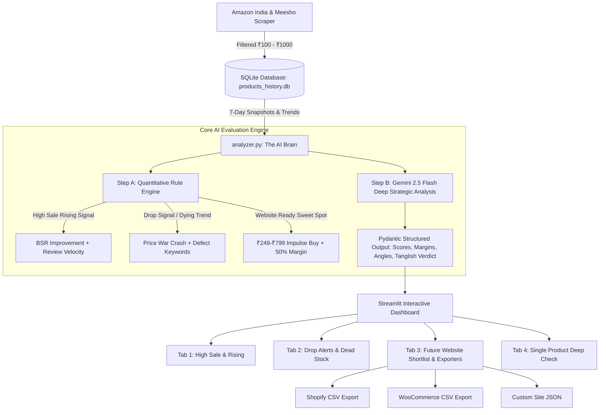

# 🚀 The Logic Inside Your Agent
### AI-Powered E-Commerce Market & Product Trend Hunter (₹100 to ₹1,000)

An autonomous AI agent designed specifically for the **Indian e-commerce market (Amazon India & Meesho)** to uncover high-margin winning products priced between **₹100 and ₹1,000 INR** to sell on future standalone Direct-to-Consumer (D2C) e-commerce websites (Shopify, WooCommerce, or custom stores).

---

## 🌟 Key Architecture & "The Logic Inside"



### 1. `storage.py` (SQLite Historical Tracker)
- **`products`**: Unique product ID, platform, title, category, URL, image, first seen date.
- **`daily_metrics`**: Daily snapshots of price, rating, review count, BSR (Best Seller Rank), and customer review snippets.
- **`ai_analysis`**: Trend status (`High Sale Rising`, `Dropping`, `Stable`), sellability score (0-100), website ready status, sourcing cost estimate, recommended selling price, customer pain points, marketing hooks, and Tanglish/English explanations.
- **`storefront_shortlist`**: Products approved by the user with custom selling prices and launch notes.
- **Historical Math Helpers**: Computes 7-day price drop %, review velocity (new reviews added in past 7 days), and BSR rank improvement % (lower rank = higher sales).
- **`seed_demo_data()`**: Seeds 10 realistic Indian products with 7 days of historical metrics so the dashboard works out of the box.

### 2. `scraper.py` (Indian Market Data Collector)
- Scrapes **Amazon India** Movers & Shakers / Best Sellers and **Meesho** catalog listings.
- Strictly bounds prices: `100 <= price <= 1000`.
- Rotating User-Agent headers, anti-bot handling, and Playwright headless structure.
- **Resilient Fallback**: If marketplace CAPTCHAs/rate-limits block automated requests, it gracefully switches to live simulated batches or CSV imports, ensuring zero pipeline halts.

### 3. `analyzer.py` (The AI Brain)

**Important:** Suggested sourcing costs, retail prices, and margins are heuristic estimates, not supplier quotes or guaranteed profits. Verify costs, shipping, GST, payment fees, returns, ad spend and affiliate eligibility before investing.
- Built on the official `google-genai` SDK using `gemini-2.5-flash` with structured Pydantic schema (`ProductAnalysisResult`).
- **Two-Step Evaluation**:
  - **Step A (Rule-Based Scoring)**:
    - *High Sale (Rising)*: Price ₹100–₹1000, Rating >= 4.0, 30–450 reviews (high demand, low saturation), and BSR climbing or review velocity increasing.
    - *Drop Signal (Dying Trend)*: Continuous price war drop (>15% in 7 days), rating < 3.7, or negative review keywords (`"cheap quality"`, `"broken"`, `"duplicate"`, `"not working"`, `"waste of money"`).
    - *Website Ready Sweet Spot*: Impulse price (₹249–₹799), lightweight/low shipping cost, non-branded generic, allowing 35%–55% markup margin over Surat/Delhi wholesale sourcing.
  - **Step B (Gemini 2.5 Flash Deep Analysis)**:
    - Analyzes consumer psychology, wholesale procurement feasibility, ad hook angles, red flags, and generates a concise Tanglish/English punchline (`ai_summary_tamil_english`).
  - **Intelligent Fallback**: If `GEMINI_API_KEY` is not provided in `.env`, it automatically runs the full Rule-Based Engine without throwing exceptions.

### 4. `auto_agent.py` (100% Fully Autonomous Background Runner)
- **Auto-Pilot Loop**: Runs periodically (every 5 minutes in test mode or every 4 hours in production).
- **Automated Workflow**:
  1. Runs `scraper.py` across Amazon India & Meesho.
  2. Updates daily snapshots in `storage.py`.
  3. Executes `analyzer.py` on all products.
  4. Automatically promotes winning products (`sellability_score >= 80` AND `website_ready == True`) directly to `storefront_shortlist`.
  5. Logs run execution stats to the `agent_logs` SQLite table.
  6. Sends instant Telegram alerts via webhook if `TELEGRAM_BOT_TOKEN` and `TELEGRAM_CHAT_ID` are configured.
- **Standalone CLI or In-App**: Can be triggered directly from the Streamlit sidebar or launched as a headless server process.

### 5. `app.py` (Streamlit Interactive Dashboard)
- **Sidebar Auto-Pilot Mode**:
  - Live agent status badge (`🟢 ACTIVE` / `⚪ STANDBY`).
  - Interval selector (5 mins test, 1 hr, 4 hrs, 12 hrs).
  - 1-Click Cycle trigger and Start/Stop scheduler buttons.
  - Live log viewer showing historical autonomous execution stats.
- **Tab 1: 🔥 High Sale & Rising (Buy / Stock)**: Identifies products gaining rank velocity with Plotly BSR charts, KPI metrics, and 1-click shortlist buttons.
- **Tab 2: 📉 Drop Alerts (Avoid Dead Stock)**: Flags products suffering margin erosion, price wars, or quality complaints to protect your capital.
- **Tab 3: 🛒 Future Website Ready (Shortlist & Exporters)**: Storefront economics calculator, unit economics breakdown, and 1-click exports to:
  - **Shopify Product CSV**
  - **WooCommerce Product CSV**
  - **Custom Site Catalog JSON**
- **Tab 4: 🔍 Single Product Deep Check**: Instant analyzer for any custom product URL, price, and customer review snippets.

---

## 🛠️ Quick Installation & Setup

### Prerequisites
- Python 3.10+ (Python 3.12 recommended)
- (Optional) Free Google Gemini API Key from [Google AI Studio](https://aistudio.google.com/app/apikey)
- (Optional) Telegram Bot token and Chat ID for instant mobile alerts

### Step 1: Clone or Navigate to the Project Folder
```bash
cd "c:\Users\georg\OneDrive\Desktop\The Logic Inside Your Agent"
```

### Step 2: Set up Virtual Environment & Install Dependencies

#### Using standard Python `venv`:
```bash
python -m venv .venv
# On Windows:
.venv\Scripts\activate
# On macOS/Linux:
source .venv/bin/activate

pip install -r requirements.txt
```

#### OR using `uv` (Ultra-Fast):
```bash
uv venv .venv --python 3.12
.venv\Scripts\activate
uv pip install -r requirements.txt
```

### Step 3: Configure Environment Variables (Optional)
Copy `.env.example` to `.env`:
```bash
cp .env.example .env
```
Add your keys in `.env`:
```env
GEMINI_API_KEY=your_gemini_api_key_here
TELEGRAM_BOT_TOKEN=your_telegram_bot_token_here
TELEGRAM_CHAT_ID=your_telegram_chat_id_here
```
*(You can also paste your Gemini API key directly into the Streamlit sidebar at any time!)*

### Step 4: Run the Application

#### Option A: Launch Interactive Dashboard (with Sidebar Auto-Pilot)
```bash
.venv\Scripts\streamlit run app.py
```
Open `http://localhost:8501` and toggle **Autonomous Mode** on from the sidebar.

#### Option B: Run Autonomous Background Agent via CLI
```bash
# Test cycle every 5 minutes:
.venv\Scripts\python auto_agent.py --test-5min

# Production schedule every 4 hours:
.venv\Scripts\python auto_agent.py --interval-hours 4

# Run a single autonomous cycle now and exit:
.venv\Scripts\python auto_agent.py --once
```

---

## 📊 File Structure

```
The Logic Inside Your Agent/
├── app.py                  # Streamlit interactive multi-tab dashboard + Auto-Pilot sidebar
├── auto_agent.py           # 100% Autonomous background agent loop & scheduler
├── analyzer.py             # Core AI Brain (Rule engine + Gemini 2.5 Flash SDK)
├── scraper.py              # Amazon India & Meesho collector with fallbacks
├── storage.py              # SQLite historical tracker (products_history.db)
├── requirements.txt        # Python dependency manifest (with apscheduler & schedule)
├── .env.example            # Environment variable template (Gemini & Telegram)
├── .env                    # Local environment config
├── products_history.db     # SQLite database (auto-generated, seeded, and logged)
└── README.md               # Documentation & setup instructions
```

---

## 💡 How to Use the Dashboard

1. **Start the app**: Open `http://localhost:8501` in your browser.
2. **Enable Auto-Pilot**: In the sidebar, select your preferred interval and click **▶️ Activate Auto**. The agent will automatically scan, analyze, and shortlist winners without human intervention.
3. **Review Rising Winners**: Check **Tab 1** for high-velocity items with 50%+ profit margin.
4. **Queue for Your Store**: Review auto-shortlisted winners or manually click **➕ Add to Website Shortlist**.
5. **Export Catalog**: Go to **Tab 3** to download ready-to-import CSVs for **Shopify**, **WooCommerce**, or JSON for custom builds.
6. **Check Any Product**: Go to **Tab 4** and paste any link, price, or review to get an instant AI verdict.


## Data Integrity & Verification

- Live scrape results may be incomplete or blocked. No simulated products are inserted into a live scan.
- Missing rating/review/BSR data is not filled with optimistic defaults.
- Social history is not generated when live evidence is absent; legacy trend history without source provenance is ignored.
- Run checks with `python -m compileall -q .` and `python -m unittest discover -s tests -v`. GitHub Actions runs these checks on branch pushes and pull requests.
- Demo-seeded products and CSV imports should be labeled and verified before any purchasing or marketing decision.
